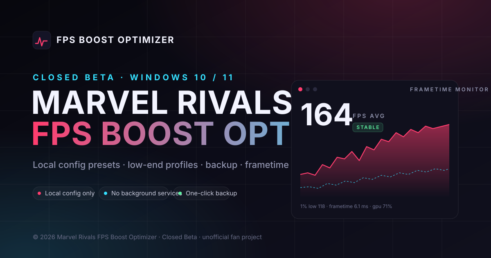

# Marvel Rivals FPS Boost Optimizer

**Closed beta utility for turning Marvel Rivals graphics settings into repeatable, measurable presets.**

---

## About

**Marvel Rivals FPS Boost Optimizer** is a Windows desktop utility for players who are tired of changing one graphics slider at a time and forgetting which combination helped. It reads the local configuration, saves a timestamped copy of the original, and applies a named preset whose every change is listed before anything is written.

A preset is only useful if you can measure it, so the frametime monitor reads the session log afterwards and reports average FPS, 1% lows and stutter count. Everything runs on your own machine, with no account, no telemetry and no background process.

This repository is the documentation hub for the closed beta. The current build, the archive password and the install notes live on the landing page linked below.

## What it does

| Feature | What you get |
| --- | --- |
| **FPS presets** | Performance, balanced and quality profiles, each with a readable diff before it is applied. |
| **Low-end PC profiles** | Three tiers for older laptops and budget builds, cutting the most expensive settings first while keeping resolution scale readable. |
| **Config backup** | A timestamped snapshot of the original configuration, plus a restore point for every change you keep. |
| **Graphics optimizer** | Flags combinations that cost frametime without a visible gain, such as redundant effects or shadow values past the point of return. |
| **Frametime monitor** | Charts average FPS, 1% lows and spike count, so two presets can be compared fairly. |
| **Preset diff review** | Every changed value is shown in plain language with the old and new value side by side. |
| **Portable preset notes** | Exports a preset as a readable summary to keep next to the backup or paste into a support thread after a patch. |

## How it works

1. **Snapshot the current state.** The utility reads the local configuration and stores a copy with a timestamp and the game build it came from.
2. **Choose a preset.** Pick a performance profile or a low-end tier, then open the diff window and read exactly which settings will move.
3. **Apply, play, and measure.** After a session, load the frame log and compare average FPS, 1% lows and spike count against the previous run.
4. **Keep or roll back.** Keep the preset that wins, or restore the original snapshot in one click and start again.

## Why local-only matters

- The utility reads and writes configuration files on disk only — no injection, no memory editing, no overlay hooks.
- A backup is taken before the first change, and the original state is kept as its own snapshot.
- Nothing runs in the background once the window is closed.
- There is no account system, no telemetry and no network feature inside the app.
- Every applied change can be reversed without reinstalling the game.

Closed beta means the preset list and the configuration format can change between builds. If a patch restructures the settings, wait for a build that matches the new layout instead of forcing an old preset.

## Requirements

| Item | Requirement |
| --- | --- |
| System | Windows 10 or Windows 11, 64-bit |
| Memory | 4 GB RAM or more |
| Storage | A small amount of free space for the app and its backups |
| Game | Marvel Rivals installed locally with a configuration already created |
| Session | The game closed while a preset is applied, then launched normally |

## Download

The beta build is distributed through the landing page, which always carries the current version, the archive password and the install notes:

**[Open the landing page → Download](https://cliffyoreside.github.io/marvel-rivals-fps-boost-performance-optimizer/#download)**

Builds are replaced between test sessions, so take the download from there rather than from a mirror or a shared copy.

## FAQ

Does the tool touch the game process or its memory?

No. It works with local configuration files and takes a backup before writing anything. It does not inject code, attach to the running process or draw an overlay.

Will it guarantee more FPS?

No. The presets reduce GPU and CPU load in ways that usually help mid-range hardware, but the result depends on your components, drivers and the current game build. The frametime monitor exists so you can measure the change rather than trust a promise.

What if a preset makes performance worse?

Restore the snapshot taken before the change. The original configuration is stored separately, so you can always return to stock settings.

Does it still work after a game patch?

Usually, but a patch can rename or restructure settings. If the utility reports an unknown configuration layout, do not force an old preset — wait for a beta build that matches the new format.

Can I compare two presets properly?

Yes. Run one preset for a full session, load the frame log, then switch and repeat. Compare average FPS with 1% lows and spike count; the lowest frames are what you feel in a fight.

Is this an official Marvel Rivals tool?

No. It is an unofficial fan project, not affiliated with or endorsed by the game's publisher. Use it at your own risk and review the game's terms before changing files on disk.

## Keywords

Marvel Rivals FPS boost, Marvel Rivals performance optimizer, Marvel Rivals stutter fix, Marvel Rivals graphics settings, Marvel Rivals low-end PC profile, Marvel Rivals config backup, frametime monitor, Windows 11 gaming utility, 2026 performance tuning.

## Disclaimer

This is an unofficial fan-made project. It is not affiliated with, sponsored by or endorsed by the publisher of Marvel Rivals, and it includes no game assets, logos or characters. The utility changes local configuration files only. Results vary by hardware and game build, no performance level is promised, and you use it at your own risk.